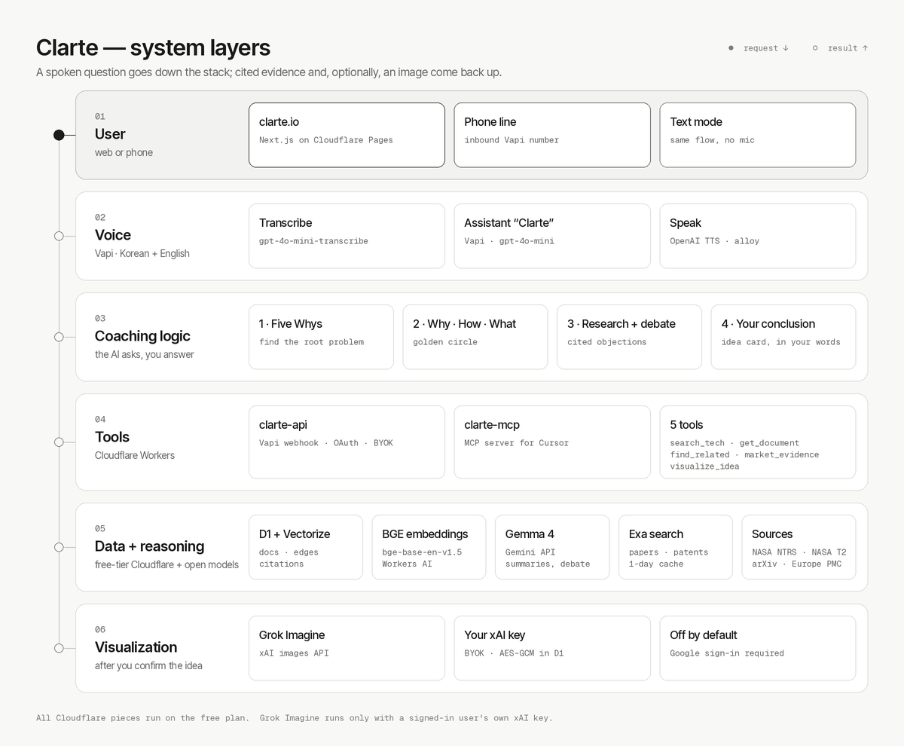

# Clarte

**A voice brainstorming partner that asks the questions, and a library of real space technology to back up your answers.**

You talk to Clarte on [clarte.io](https://clarte.io) or by phone. It does not hand you an answer. It walks you through four
stages of critical thinking, pulls cited evidence from NASA reports, NASA patents, and arXiv papers as you speak, and at the
end reads your own conclusion back to you as an idea card. If you choose, Grok Imagine then renders that idea.

Built in one day at **[Hacktoberfest Hack Day San Diego × SpaceXSI](https://www.mlh.com/events/hacktoberfest-x-spacexai-hack-day-uc-san-diego)**
(UC San Diego, hosted by DS3, 2026-10-25), with Cursor.

**Site:** https://clarte.io · **API:** https://api.clarte.io · **MCP:** https://mcp.clarte.io · **License:** MIT

## Hackathon ideation

The idea came out of a planning session with Grok Bot agents in the team's group chat, one researching the event rules, one
the data sources, and one the platforms and free-tier limits. The full plan is [readme/PLAN.md](readme/PLAN.md).

- **Problem.** Engineers, researchers, and founders keep re-solving problems someone already solved. Usable technology
  such as NASA reports, NASA patents, papers, and public software is scattered, and keyword search only works if you
  already know the words. A fix written in another field's vocabulary never shows up: the answer to drone battery
  overheating may sit in a satellite thermal-control patent. And at the idea stage, people often don't yet know what to
  look for at all.
- **Theme fit.** The SpaceXSI category asks for real space data, Cursor, and Grok Imagine or Voice. NASA's technical
  reports and technology-transfer catalog are exactly that kind of under-used, cross-domain technology, so the first
  library is space technology. Grok Imagine closes the session by turning the user's own idea into an image. The
  open-weight focus of Hacktoberfest Hack Day maps to Gemma 4 for reasoning and BGE for embeddings.
- **Why this idea.** Existing research tools (Elicit, Consensus, Connected Papers, ResearchRabbit, Google Scholar, Google
  Patents) find and summarize documents. Clarte puts a partner that asks questions before the search, so the user
  sharpens the problem first, and then links technologies by meaning across domains instead of by keyword or citation.
  The positioning: if 21st.dev is the component library for designers, Clarte is the paper and patent library for
  engineers.
- **Who it's for.** Students and hackathon builders first, then deep-tech founders checking prior art or licensable NASA
  technology, then lab and R&D teams.

The competitor comparison is how the team sees the difference; it was not a feature-by-feature review.

## How a session works

| Stage | What Clarte does | What you do |
|---|---|---|
| **1 · Five Whys** | Asks "why" until the root problem is on the table | Name the real problem, not the symptom |
| **2 · Why · How · What** | Walks the golden circle: purpose, approach, then the thing you'd build | Say why it matters, how it could work, and what it is |
| **3 · Market research and debate** | Searches the library and the web, then argues back with cited objections | Defend, change, or drop parts of the idea |
| **4 · Your conclusion** | Reads your own words back as an idea card, without adding its answer | Confirm the card |

The coach prompt in [`product/prompts/coach.md`](product/prompts/coach.md) forbids giving the user the answer in stages 1
and 4. Every piece of evidence carries its source URL, and the site shows the sources next to the knowledge graph.

## System layers



Static version: [docs/images/clarte-system-layers.png](docs/images/clarte-system-layers.png)

| Layer | What runs there | Code |
|---|---|---|
| 01 User | clarte.io (Next.js static export on Cloudflare Pages), an inbound phone line, and a text mode with the same flow | [`website/`](website/) |
| 02 Voice | Vapi assistant "Clarte": `gpt-4o-mini` for dialogue, `gpt-4o-mini-transcribe` for speech-to-text, OpenAI TTS for speech. Korean and English. | [`product/scripts/vapi-setup.ts`](product/scripts/vapi-setup.ts), [`website/lib/voice-client.ts`](website/lib/voice-client.ts) |
| 03 Coaching logic | The four-stage flow above | [`product/prompts/coach.md`](product/prompts/coach.md), [`product/workers/shared/coach.ts`](product/workers/shared/coach.ts) |
| 04 Tools | Cloudflare Workers `clarte-api` (Vapi tool webhook, Google OAuth, BYOK key storage, graph and citation API) and `clarte-mcp` (the same tools over MCP, so Cursor can query the library). Five tools: `search_tech`, `get_document`, `find_related`, `market_evidence`, `visualize_idea`. | [`product/workers/`](product/workers/), [`tools-spec.ts`](product/workers/shared/tools-spec.ts) |
| 05 Data and reasoning | D1 (documents, edges, citations, users, Exa cache) and Vectorize, with open-weight BGE embeddings `@cf/baai/bge-base-en-v1.5` on Workers AI. Gemma 4 `gemma-4-26b-a4b-it` through the Gemini API writes summaries, tags, connection reasons, and debate objections. Exa search adds papers, patents, and NASA reports for market evidence, cached in D1 for one day. | [`product/db/migrations/`](product/db/migrations/), [`gemma.ts`](product/workers/shared/gemma.ts), [`exa.ts`](product/workers/shared/exa.ts) |
| 06 Visualization | Grok Imagine (`grok-imagine-image-2.0`, `POST https://api.x.ai/v1/images/generations`) renders the confirmed idea card | [`product/workers/shared/imagine.ts`](product/workers/shared/imagine.ts) |

The library is ingested from official public APIs: NASA Technical Reports Server (NTRS), NASA Technology Transfer (T2)
patents, spinoffs, and software, arXiv space categories, and Europe PMC. Each document stores its source URL and license
status. See [readme/data_sources.md](readme/data_sources.md).

## Hackathon requirements and what Clarte uses

Requirements come from the [MLH event page](https://www.mlh.com/events/hacktoberfest-x-spacexai-hack-day-uc-san-diego). The
event is a one-day build focused on open-source and open-weight AI, with three prize categories.

| Category | What the event asks for | How Clarte uses it | Status |
|---|---|---|---|
| **SpaceXSI: Make it Legendary** | Build something using **real space data** | NASA NTRS reports, NASA T2 patents, spinoffs, and software, and arXiv space papers, all from official APIs | Live: 120 documents in D1 and Vectorize, 600 edges in D1. Ingest in [`product/ingest/sources/`](product/ingest/sources/) |
| | **Eligibility: built with Cursor**, and the more you lean on Cursor the better | The whole repo was written with Cursor and Cursor cloud agents. `clarte-mcp` makes the library queryable from Cursor. | Done; see `git log` |
| | **Use the Grok Imagine or Grok Voice API** somewhere in the project | Grok Imagine renders the final idea card through `visualize_idea`. Voice runs on Vapi, not Grok Voice. | Built. Off by default (`IMAGINE_ENABLED = "false"`). It runs only for a user signed in with Google who saved their own xAI key (BYOK, AES-GCM encrypted in D1). The team has no xAI credit, so there are no team-funded calls. |
| | **Bonus: use Grok Bot** to plan the project and collaborate | Planning, research, and task splitting ran through Grok Bot agents in the team group chat. [readme/PLAN.md](readme/PLAN.md) came out of that. | Done |
| **Best Use of Gemma 4** | Use the open-weight Gemma 4 model through the Gemini API | `gemma-4-26b-a4b-it` for ingest summaries and tags, `find_related` reasons, `market_evidence` objections, and Imagine prompts | Wired in. Runs once `GEMINI_API_KEY` is set on the API Worker; until then the live API uses local fallback summaries and replies. |
| **Best Open-Source AI Project** | Open-source or open-weight AI as an important part of how it works | MIT-licensed repo; Gemma 4 (open-weight) for reasoning; BGE `bge-base-en-v1.5` (open-weight, BAAI) for every embedding; an MCP server other agents can use | Done |

Not open-weight, for transparency: the live voice dialogue uses `gpt-4o-mini` and OpenAI speech models through Vapi, and
market evidence uses the Exa search API.

The site, API, and MCP server are deployed. Hosting stays on the Cloudflare free plan: Workers, D1, Vectorize, Workers AI, and Pages, with no paid add-ons.

More detail with file links: [readme/hackathon-requirements.md](readme/hackathon-requirements.md).

## Stack

- **Voice:** Vapi (`@vapi-ai/web` in the browser, a phone number for calls), OpenAI `gpt-4o-mini`, `gpt-4o-mini-transcribe`, OpenAI TTS
- **Reasoning:** Gemma 4 `gemma-4-26b-a4b-it` (Gemini API)
- **Search and data:** Cloudflare D1, Vectorize, Workers AI BGE embeddings, Exa search, NASA NTRS, NASA T2, arXiv, Europe PMC
- **Backend:** Cloudflare Workers (TypeScript), Google OAuth handled in the Worker, MCP server over Streamable HTTP
- **Images:** Grok Imagine (xAI), bring your own key
- **Frontend:** Next.js 16, React 19, Tailwind CSS, `motion` (Framer Motion), `react-force-graph-3d` and three.js for the knowledge graph, components adapted from [21st.dev](https://21st.dev)
- **Built with:** Cursor, Cursor cloud agents, Grok Bot

## Repository layout

```
readme/     project docs: overview, architecture, setup, demo script, requirements, plan
product/    Cloudflare Workers (API + MCP), D1 migrations, ingest pipeline, prompts, Vapi setup script
website/    Next.js frontend: landing page, session screen, 3D graph, Vapi mic, idea card
docs/       images used by this README
```

## Run it

```bash
git clone https://github.com/haminxx/Clarte.git
cd Clarte
cp .env.example .env
cp product/.dev.vars.example product/.dev.vars
cp website/.env.example website/.env.local
(cd product && npm install)
(cd website && npm install && npm run dev)
```

D1, Vectorize, secrets, ingest, Vapi, and deploy commands are in [readme/setup.md](readme/setup.md). Text mode works with
empty keys; voice, Google sign-in, Gemma, Exa, and Grok Imagine each need their own key.

No keys are committed. Templates: [.env.example](.env.example), [product/.dev.vars.example](product/.dev.vars.example),
[website/.env.example](website/.env.example).

The D1 database is still named `paber` and the Vectorize index `paber-docs`. Those names predate the rename to Clarte.
Code uses the bindings `DB`, `VECTORS`, and `AI`.

## Docs

| Doc | What it covers |
|---|---|
| [readme/overview.md](readme/overview.md) | What Clarte is, who it's for, and the conversation |
| [readme/architecture.md](readme/architecture.md) | Layers, API paths, data model, and tools |
| [readme/setup.md](readme/setup.md) | D1, Vectorize, secrets, Vapi, ingest, deploy |
| [readme/data_sources.md](readme/data_sources.md) | Where the documents come from and their licenses |
| [readme/demo-script.md](readme/demo-script.md) | The demo, line by line |
| [readme/hackathon-requirements.md](readme/hackathon-requirements.md) | Each requirement with file links |
| [readme/PLAN.md](readme/PLAN.md) | Product plan and system design |

## License and credits

MIT, © 2026 Christian Lee. See [LICENSE](LICENSE).

Data from NASA NTRS, NASA Technology Transfer, arXiv, and Europe PMC belongs to its publishers; Clarte links back to every
source. Brand logos on the site belong to their owners and appear only to show what Clarte is built with. UI components
adapted from 21st.dev authors are credited in their source files.
