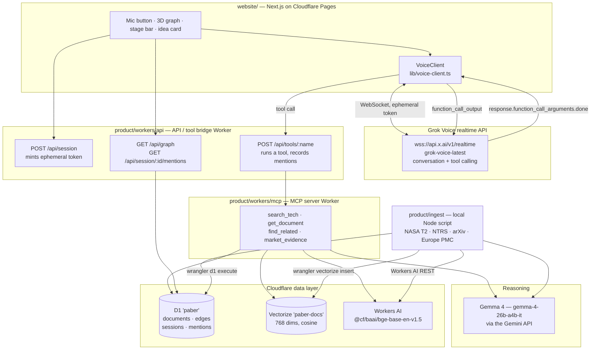

# Architecture

## Layers



## Why Grok runs the conversation and Gemma runs the tools

Grok Voice is a single realtime agent: speech in, conversation, speech out, with tool calling. Its
internal model cannot be swapped for Gemma. So **Grok is the conversational brain** and **Gemma 4 is
the reasoning LLM behind the tools** — it writes every document summary and domain tag at ingest time,
the one-line "why these connect" reason in `find_related`, and the three cited objections in
`market_evidence`. Both the Grok requirement and the Gemma requirement are met by work that actually
happens, not by a token call.

## Request paths

**Starting a session.** The browser posts to `/api/session`. The Worker inserts a `sessions` row,
calls `POST https://api.x.ai/v1/realtime/client_secrets` with the server-side `XAI_API_KEY`, and
returns a short-lived token plus the full `session.update` payload (system prompt from
`prompts/coach.md`, the four tool schemas, 24 kHz PCM audio, server VAD). The API key never leaves the
Worker; the browser authenticates with the `xai-client-secret.<token>` WebSocket subprotocol.

**A tool call.** Grok emits `response.function_call_arguments.done`. The browser forwards name and
arguments to `/api/tools/:name`, which runs the shared implementation, writes the touched document ids
into `mentions`, and returns the result. The browser sends it back as a `function_call_output` item,
and only after every outstanding call has answered does it send one `response.create` — the documented
requirement for parallel tool calls.

**Highlighting.** Two paths, on purpose. The voice path sets highlights directly from the tool
response. The website also polls `/api/session/:id/mentions?since=<seq>`, so a tool call made from
anywhere else — an MCP client, `curl`, a second tab — still lights up the graph.

## The four tools

Defined once in [`workers/shared/tools-spec.ts`](../product/workers/shared/tools-spec.ts) and
implemented once in [`workers/shared/tools.ts`](../product/workers/shared/tools.ts), so the MCP server
and the voice bridge can never drift apart.

| Tool | Input | Output | Internals |
|---|---|---|---|
| `search_tech` | `query`, `limit` | nodes with id, title, source, summary, score | embed query with Workers AI, query Vectorize, join D1; falls back to keyword search |
| `get_document` | `id` | summary, domain tags, source URL, licence status | D1 lookup |
| `find_related` | `id`, `cross_domain`, `limit` | neighbour nodes and why they connect | `edges` table, other-domain filter, Gemma writes the reason; live nearest-neighbour fallback when a node has no edges yet |
| `market_evidence` | `idea`, `limit` | prior art plus three cited objections | `search_tech` then the Gemma 4 debate prompt |

The same MCP server can be connected to Cursor during development:

```json
{ "mcpServers": { "paber": { "url": "https://paber-mcp.<subdomain>.workers.dev/mcp" } } }
```

## Data model (D1 `paber`)

```sql
documents(id PK, source, source_id, type,        -- paper|patent|report|software|spinoff
          title, abstract, summary, domains,     -- domains is a JSON array
          url, published, center, license_status, created_at)
edges(src, dst, weight, reason, cross_domain, PRIMARY KEY(src, dst))
sessions(id PK, stage, root_cause, idea_json, created_at)
mentions(seq PK AUTOINCREMENT, session_id, doc_id, ts)
```

Vectorize `paber-docs` holds one 768-dimension vector per document, with the vector id equal to
`documents.id`, so a vector hit joins straight back to metadata. `mentions.seq` is the cursor the
website polls with; everything else follows plan section 6.4 exactly.

Edges are built during ingest: each document's top five cosine neighbours, with `cross_domain = 1`
when the two documents share no domain tag. Those cross-domain edges are what produce "satellite
thermal control → drone battery cooling".

## Why ingest runs locally

Free Workers get 10 ms CPU and 50 subrequests per request. Fetching hundreds of documents and then
calling Gemma 4 and an embedding model per document does not fit in one invocation, and splitting it
across invocations would be a queue for no reason on demo day. So
[`product/ingest/run.ts`](../product/ingest/run.ts) runs once in Node and writes artifacts into
`product/data/`:

- `sql/documents-*.sql` and `sql/edges-*.sql` — chunked `INSERT OR REPLACE` statements for `wrangler d1 execute`
- `vectors.ndjson` — one `{id, values, metadata}` line per document for `wrangler vectorize insert`
- `documents.json` and `manifest.json` — for inspection and counts

[`product/ingest/load.ts`](../product/ingest/load.ts) applies the migration and pushes both.

## Degradation without keys

Everything builds and runs with no keys at all, which is why the scaffold can be verified before
Christian's keys arrive.

| Missing | What happens |
|---|---|
| `XAI_API_KEY` | `/api/session` returns `stubbed: true` with an empty token. The UI disables the mic, says why, and the text-mode box still drives the same tools and highlights. |
| `GEMINI_API_KEY` | Ingest falls back to a first-two-sentences summary and regex domain tags. `market_evidence` still returns real, cited objections built from retrieval alone, flagged in its `gaps` field. |
| Cloudflare credentials during ingest | Embeddings fall back to a deterministic hashed bag-of-words vector of the same 768 dimensions, so Vectorize round-trips and edges still build. Semantically weak, structurally correct. |
| Vectorize unreachable (local dev) | `search_tech` catches the failure and answers from a scored D1 `LIKE` search. |
