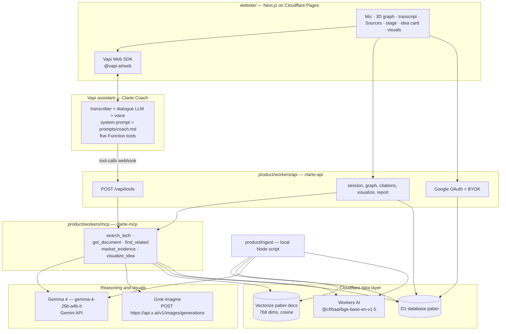

# Architecture

This is the v3 design in [PLAN.md](PLAN.md). The website and the API Worker share one set of paths,
listed below. Voice is Vapi. Grok Imagine runs server-side, only after the idea is confirmed, and
only for a Google-signed-in user with an encrypted xAI key.

## Layers



Targets: website https://clarte.io (Cloudflare Pages project `clarte-web`), API
https://api.clarte.io (Worker `clarte-api`), MCP https://mcp.clarte.io (Worker `clarte-mcp`). Until
DNS for `clarte.io` is live, the same deploys answer on `*.pages.dev` and `*.workers.dev`.

## Who does what

**Vapi** is the voice layer: speech-to-text, the dialogue model, text-to-speech, and the decision to
call a tool. **Gemma 4** is the reasoning model behind the tools: summaries, tags, cross-domain
reasons, debate counter-arguments, and the prompts sent to Imagine. **Grok Imagine** turns a
confirmed idea card into images. The browser never holds the Imagine key, the Vapi private key, or
the Vapi server secret.

## One conversational turn

1. The browser starts a call with `new Vapi(NEXT_PUBLIC_VAPI_PUBLIC_KEY).start(NEXT_PUBLIC_VAPI_ASSISTANT_ID)` and passes the Clarte `sessionId` in call metadata.
2. Vapi transcribes, and its model decides to call a tool.
3. Vapi POSTs `{ message: { type: "tool-calls", toolCallList } }` to `POST /vapi/tools`.
4. The Worker checks the `x-vapi-secret` header, runs the MCP tool, and writes `mentions` and `citations`.
5. The Worker responds HTTP 200 with `{ results: [{ toolCallId, result }] }`. `result` is one compact JSON string. On a tool failure the item is `{ toolCallId, error }` and has no `result`.
6. Vapi speaks the answer. During the call the website reads transcript and tool payloads from the Vapi client `message` events. It also polls `GET /api/session/:id/mentions?since=` for graph highlights and `GET /api/session/:id/citations` for the Sources panel, so a tool call from curl or Cursor updates the page too.

PLAN.md's data-flow sketch also names a session events poll. The website and the Worker use the `mentions` and `citations` paths in the next section.

## HTTP API

Base URL for the website: `NEXT_PUBLIC_CLARTE_API`. CORS allows `https://clarte.io`,
`http://localhost:3000`, and the Pages preview origin, with credentials.

### Voice webhook

`POST /vapi/tools`

- Header `x-vapi-secret` must equal `VAPI_SERVER_SECRET`. A missing or wrong secret is HTTP 401. That is the only non-200 response on this route. If `VAPI_SERVER_SECRET` is unset, accept the call so local dev still works, and log a warning.
- Handle `message.type === "tool-calls"`. Any other type returns `{ results: [] }`.
- Each item in `message.toolCallList` (also accept `message.toolCalls`) has `id`, `function.name`, and `function.arguments` (object or JSON string).
- Session id: `message.call.metadata.sessionId`, else assistant variable `sessionId`. Create the session row if needed.
- Document objects inside the JSON `result` always include `id`, `title`, `type`, `source`, and `url`.

`visualize_idea` takes an optional `session_id` (otherwise the call metadata) and `kinds`: `concept`,
`system_diagram`, `paper_figure`. The Worker refuses unless `IMAGINE_ENABLED` is true, the session
user is signed in, and `user_keys` has an xAI key. The refusal is a tool `error` string the assistant
can speak, not an HTTP error.

### Session, graph, citations

| Method and path | Body / query | Response |
|---|---|---|
| `POST /api/session` | `{ sessionId? }` | `{ sessionId, stage }` |
| `POST /api/chat` | `{ sessionId, message }` | `{ reply, stage, citations, highlight }` — text-mode coach, one turn, no Vapi |
| `POST /api/tools/:name` | same tool args the webhook uses | tool result plus `citations` (text mode and curl) |
| `GET /api/session/:id` | | stage, rootCause, idea, vapiCallId |
| `POST /api/session/:id/stage` | `{ stage }` where stage is `five_whys`, `why_how_what`, `debate`, or `visualize` | |
| `POST /api/session/:id/root-cause` | | |
| `POST /api/session/:id/idea` | | |
| `GET /api/session/:id/mentions?since=` | | highlight cursor |
| `GET /api/session/:id/citations` | | `{ citations: [{ docId, url, title, source, type, stage }] }` |
| `GET /api/session/:id/visuals` | | `{ visuals: [{ id, kind, prompt, imageUrl, model }] }` |
| `POST /api/session/:id/visualize` | `{ kinds }` | HTTP 200 `{ visuals }` or `{ error: "sign_in_required" \| "key_required" \| "disabled" }` |
| `GET /api/session/:id/report` | | `text/markdown` idea card, references, and visual URLs |
| `GET /api/graph?limit=` | | nodes and links |
| `GET /health` | | `{ service: "clarte-api", documents, vapiConfigured, gemmaConfigured, imagineEnabled }` |

Anonymous callers can use the graph, voice, tools, and citations. Imagine and `POST /me/xai-key`
require a signed-in user.

### Google sign-in and the xAI key

| Method and path | Behavior |
|---|---|
| `GET /auth/google` | Redirect to Google. `redirect_uri` is `GOOGLE_REDIRECT_URI` or `{API_URL}/auth/callback/google`. |
| `GET /auth/callback/google` | Set cookie `clarte_session`: HttpOnly, Secure (off on localhost), SameSite=Lax. `Domain=.clarte.io` only when the request host is `clarte.io` or `api.clarte.io`. Otherwise a host-only cookie. |
| `POST /auth/logout` | Clear the cookie. |
| `GET /me` | `{ user: { id, email, name } \| null, xaiKey: { connected, last4 } }`. Never return the key or its ciphertext. |
| `POST /me/xai-key` | `{ apiKey }`, session required. AES-GCM with `KEY_ENCRYPTION_KEY`. Store `last4`. Response `{ connected: true, last4 }`. |
| `DELETE /me/xai-key` | Remove the row. |

The OAuth client lives in the Google Cloud project "PABER". Authorized redirect URIs:
`https://clarte.io/auth/callback/google` and `http://localhost:8787/auth/callback/google`. Authorized
JavaScript origin: `https://clarte.io`. The pages `clarte.io/auth/*` are served by `clarte-api`
through a Worker route. Login is optional for brainstorming. It is required only to visualize.

The user's xAI key is sent once over HTTPS, encrypted in the Worker, stored in D1, decrypted only
inside the Worker for the Imagine call, and never logged. A dev `XAI_API_KEY` is for tests. Session
visuals use the signed-in user's key.

## The five tools

Defined for both the MCP server and the Vapi webhook so the two cannot drift. Vapi Function tools use
`type: "function"`, JSON-schema parameters matching this table, and
`server.url = https://api.clarte.io/vapi/tools` (one URL; the Worker dispatches on `function.name`).
Until DNS is live, `server.url` is `https://<clarte-api>.workers.dev/vapi/tools`.

| Tool | Input | Output | Internals |
|---|---|---|---|
| `search_tech` | `query`, `limit` | nodes: id, title, source, summary, score, plus `url` and `type` | embed the query, Vectorize search, join D1; keyword fallback if Vectorize is unreachable |
| `get_document` | `id` | summary, domain tags, source URL, license status | D1 lookup |
| `find_related` | `id`, `cross_domain` | neighbor nodes and why they connect | `edges`, other-domain filter; Gemma writes a one-line reason |
| `market_evidence` | `idea`, `limit` | patents and papers, each with `url`, and 3 counter-arguments | `search_tech` plus the Gemma 4 debate prompt |
| `visualize_idea` | `session_id`, `kinds` (`concept`, `system_diagram`, `paper_figure`) | image URLs and the prompts used | gated as above; Gemma writes prompts from the idea card; Worker calls Grok Imagine; rows go to `visuals` |

A compact string returned to Vapi looks like
`{"docs":[{"id":"...","title":"...","type":"patent","source":"NASA T2","url":"https://technology.nasa.gov/patent/..."}]}`.

Cursor can use the same MCP server during development:

```json
{ "mcpServers": { "clarte": { "url": "https://mcp.clarte.io/mcp" } } }
```

Use the `*.workers.dev` MCP URL until `mcp.clarte.io` resolves.

## Data model

D1 database name: `paber`. Vectorize index name: `paber-docs` (768 dimensions, cosine). Each vector
id equals `documents.id`. Bindings: `DB`, `VECTORS`, `AI`. Embeddings are Workers AI
`@cf/baai/bge-base-en-v1.5`.

```sql
documents(id TEXT PK, source TEXT, source_id TEXT, type TEXT,  -- paper|patent|report|software|spinoff
          title TEXT, abstract TEXT, summary TEXT, domains TEXT,  -- JSON array
          url TEXT,  -- required, canonical source page
          published TEXT, center TEXT, license_status TEXT, created_at TEXT)
edges(src TEXT, dst TEXT, weight REAL, reason TEXT, cross_domain INTEGER, PRIMARY KEY(src, dst))
sessions(id TEXT PK, stage TEXT, root_cause TEXT, idea_json TEXT, vapi_call_id TEXT, created_at TEXT)
mentions(session_id TEXT, doc_id TEXT, ts TEXT)
citations(session_id TEXT, doc_id TEXT, url TEXT, title TEXT, stage TEXT, ts TEXT,
          PRIMARY KEY(session_id, doc_id))
visuals(id TEXT PK, session_id TEXT, kind TEXT, prompt TEXT, image_url TEXT, model TEXT, created_at TEXT)
          -- kind: concept|system_diagram|paper_figure|video
users(id TEXT PK, google_sub TEXT UNIQUE, email TEXT, name TEXT, created_at TEXT)
auth_sessions(id TEXT PK, user_id TEXT, expires_at TEXT)
user_keys(user_id TEXT, provider TEXT, ciphertext TEXT, iv TEXT, last4 TEXT, created_at TEXT,
          PRIMARY KEY(user_id, provider))  -- provider = 'xai'
```

Edges come from each document's top 5 nearest documents. `cross_domain` is set when the domain tags
differ. Imagine image URLs may be temporary; the demo keeps `image_url` and can cache the image in
the browser. Do not enable R2 to store them. Cloudflare stays on the free plan.

The database id `38e1c167-dea2-44ab-9f18-0251c864357c` is not a secret. It is in
`product/wrangler.api.toml` and `product/wrangler.mcp.toml`.

## Why ingest runs locally

Free Workers get 10 ms of CPU and 50 subrequests per request. Fetching hundreds of documents and then
calling Gemma 4 and an embedding model for each one does not fit in one invocation.
[`product/ingest/run.ts`](../product/ingest/run.ts) runs once in Node and writes `product/data/`:

- `sql/documents-*.sql` and `sql/edges-*.sql` for `wrangler d1 execute`
- `vectors.ndjson` for `wrangler vectorize insert`
- `documents.json` and `manifest.json` for inspection

[`product/ingest/load.ts`](../product/ingest/load.ts) applies the migration and pushes both. Official
APIs only. Every document stores its source URL and license status.

## What still works with empty keys

| Missing | What happens |
|---|---|
| Vapi public key, assistant id, or server secret | The mic stays off. `POST /api/chat` still runs one coach turn and the same tools. With `VAPI_SERVER_SECRET` unset, `POST /vapi/tools` accepts calls and logs a warning. |
| `GEMINI_API_KEY` | Ingest uses a first-two-sentences summary and simple domain tags. `market_evidence` still returns retrieved documents and says the objections were not model-written. |
| Cloudflare credentials during ingest | Embeddings fall back to a deterministic 768-dimension vector so the load still round-trips. Search quality is weak until a real embed is loaded. |
| Vectorize unreachable | `search_tech` answers from a scored D1 `LIKE` search. |
| Imagine flag, Google session, or user xAI key | `visualize_idea` returns a spoken tool error. `POST /api/session/:id/visualize` returns HTTP 200 with `sign_in_required`, `key_required`, or `disabled`. The idea card and its source URLs still render. |
